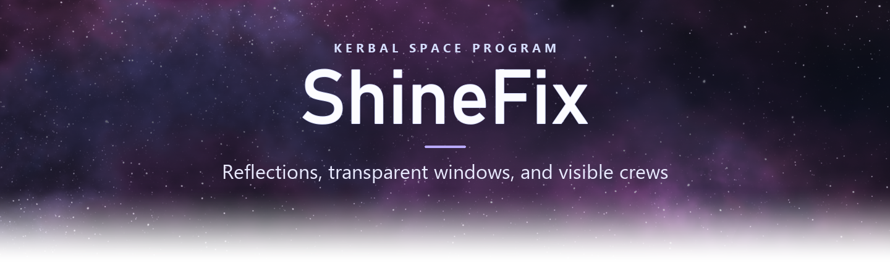

  

<h1 align="center"> ShineFix</h1>

  Reflections for solar panels and windows, transparent cabins, and visible Kerbal crews in Kerbal Space Program.

  
  
  
  
  
  

  <a href="https://github.com/rockmeowstar/KSP_ShineFix/releases">Download</a> ·
  <a href="https://github.com/rockmeowstar/KSP_ShineFix">GitHub</a> ·
  <a href="https://spacedock.info/mod/3764/ShineFix">SpaceDock</a> ·
  <a href="https://forum.kerbalspaceprogram.com/topic/225969-1125-shinefix-adds-proper-reflections-to-kerbal-space-program-1/">Forum</a> ·
  <a href="https://github.com/rockmeowstar/KSP_ShineFix/issues">Issues</a>

  <a href="https://rockmeowstar.github.io/KSP_ShineFix/support/">Support catalog</a> ·
  <a href="https://rockmeowstar.github.io/KSP_ShineFix/gallery.html">Screenshot gallery</a> ·
  <a href="https://rockmeowstar.github.io/KSP_ShineFix/support/evidence.html">Verification evidence</a> ·
  <a href="https://github.com/rockmeowstar/KSP_ShineFix/tree/legacy_shinefix">Legacy ShineFix</a>

## What’s new

- **Solar panel and window reflections.** Human verification covers **229 mods and Stock**. The release targets **1,694 unique named parts**, and the optics galleries show **1,522 distinct part IDs** across integrations with optics changes. The goal is to cover every player-created KSP part mod.
- **Kerbal helmet reflections in the main menu.** Helmet visors reflect their surroundings both in the menu and in gameplay.
- **Smoother boarding.** Small fixes reduce the hitch when Kerbals board a cabin. ShineFix updates the affected crew and reuses cabin geometry when it can.
- **Transparent windows for cabins and science modules.** See cockpit and lab interiors through their reflective glass.
- **Visible crew in the hangar.** Assign a Kerbal in the editor and see them at their seat, giving you a reference for the size and proportions of the craft.
- **FreeIVA-style movement in Through The Eyes of a Kerbal.** The optional controls make movement from IVA to first-person EVA feel continuous. The integration lives in ShineFix alongside the interior optimization that makes visible cabin windows practical without boarding hitches.
- **Readable interiors with the lights on.** Window glow is tuned so the cabin and Kerbals remain visible through the glass.
- **Live transparency switching.** Choose semi-transparent reflective windows or the classic ShineFix look with opaque reflective windows. The change applies as soon as you toggle it.
- **Built from scratch.** ShineFix 2.0 reuses no protected asset files from KSP or other mods. The mod author created all texture masks, which ShineFix applies to installed materials at runtime.
- **Reflections and transparency survive recoloring.** A key difference in ShineFix 2.0 is that changing a supported part's paint keeps the effects aligned with its windows and reflective surfaces.
- **A dedicated in-game toolbar icon.** Click **SF** in the KSP toolbar to open ShineFix settings and quickly change window transparency or access the optional first-person EVA controls.

## Runtime requirements

The verified target is **KSP 1.12.5 on Windows x64 with Direct3D 11**. Install [HarmonyKSP](https://github.com/KSPModdingLibs/HarmonyKSP), [ModuleManager](https://github.com/sarbian/ModuleManager), and [Deferred](https://github.com/LGhassen/Deferred) with its required shader loader [Shabby](https://github.com/KSPModdingLibs/Shabby).

[FreeIVA](https://github.com/pizzaoverhead/FreeIva) is needed for the optional bridge. [Through The Eyes of a Kerbal](https://github.com/FirstPersonKSP/Through-The-Eyes) is needed for the optional first-person EVA controls. The download links currently point to the published legacy releases. The 2.0.0-rc2 catalog and verification evidence are available above.

## License

ShineFix-owned code and mod assets are licensed under [GNU GPL version 3 or later](LICENSE). The KSP screenshots depict game and community-mod assets whose rights remain with their respective owners. The banner was rendered with [Procedural Nebula v5](https://github.com/rockmeowstar/procedural-nebula).

## AI disclosure

The author estimates AI contribution at **2% of the code** and **72% of the tests**.

## Performance disclaimer

> The official single-cabin measurement recorded a **0.046% FPS decrease** with one visible interior, its crew and window glass, relative to the same case with reflections disabled. This figure describes that measured configuration.
